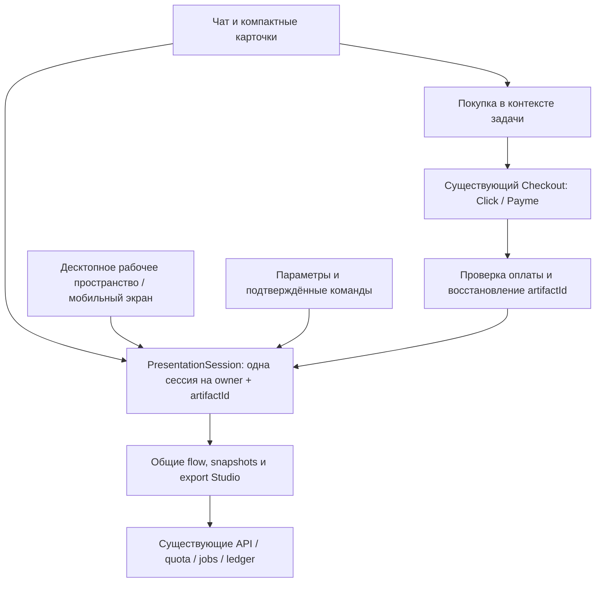

# Презентации внутри чата: критика и новая концепция интерфейса

Дата: 08.10.2026. Это аудит и предложение следующей версии. Код приложения, API, БД и production не изменялись; новая концепция не опубликована.

## Вердикт

Интеграция убрала переход на отдельную страницу и сохранила общий механизм генерации, оплаты и экспорта. Однако интерфейс остался большой самостоятельной формой Studio, вставленной в сообщение ассистента. Пользователь ожидает работать с презентацией через чат, а получает два конкурирующих места ввода и настройки без рабочего пространства для результата.

Моя ошибка — принять отсутствие редиректа, устойчивость сохранения и прохождение технических проверок за завершённость продуктового сценария. Эти проверки полезны, но не доказывают понятность интерфейса. Следующий этап должен изменить способ работы с результатом, а не просто оформление формы.

## Что проверено

- Репозиторий: `F:/Claude/gptbot-codex-integration-20261007`, ветка `codex/continuation-20261007`; до аудита рабочее дерево чистое, HEAD `2a32458f`.
- Live `/gptbot-release.json` подтвердил код production `c4cd8c701d383f1139486c91b30cd5c2bf7f46e2`.
- Изучены чат, общий адаптер Studio, Form, Preview, export, локальное хранилище и обе поверхности покупки.
- Живой сайт открыт в чистых браузерных контекстах Edge: RU 1920×1080, 1440×900, 390×844, 360×640; UZ 320×700. GET выполнялись к настоящему сайту. Генерация, создание заказов и POST телеметрии перехватывались: денег и AI-единиц аудит не расходовал.
- Источник измерений: `reports/chat-studio-ux-20261008/live-layout.json`; начальные скриншоты находятся рядом.
- Размеры измерены без браузерной панели телефона. Это не проверка реальной клавиатуры iOS/Android и не доказательство поведения всех встроенных браузеров.

| Наблюдение | Измерение / доказательство | Значение для пользователя |
|---|---|---|
| Десктопная форма почти не использует широкое окно | Ширина 768 px и при 1920, и при 1440; высота исходной карточки 597 px | Свободное пространство не помогает читать или редактировать слайды |
| Мобильная форма чрезмерно вложена | Поле темы: 260 px при ширине 390, 230 при 360, 190 при 320 | Рамки и отступы съедают полезную ширину |
| Покупка раздувает сообщение | При выборе полного формата карточка: 1076 px на десктопе, 1380 / 1452 / 1585 px на мобильных ширинах 390 / 360 / 320 | Параметры, тарифы и объяснения требуют длинной прокрутки |
| Два ввода одновременно | В карточке — тема; внизу — постоянный обычный chat composer | Неясно, куда писать и к чему относится следующая команда |
| Автопрокрутка работает против настройки | После открытия в проверке 360 и 320 поле темы оказалось выше видимой области | Отсутствие горизонтального overflow ещё не означает удобный старт |
| Верхняя покупка относится к другому продукту | Открытый live dialog: «AI-пакет: больше ответов в этом чате», 20 000 сум, 300 ответов | Покупатель презентации может выбрать пакет, который не даёт Studio-единиц |

## Критика архитектуры и сценария

### 1. Карточка стала отдельным приложением в ленте

`src/gpt-chat/parts/chat-presentation.tsx` монтирует целую `PresentationCard`, тарифы, покупки и пояснения внутри каждого сообщения. `AiChatMessageList.tsx:169` выводит такую поверхность для каждой ссылки на презентацию. Настройки, длинный результат и платёжные блоки растягивают разговор; несколько презентаций создают несколько больших независимых интерфейсов.

Карточка в разговоре должна отвечать на четыре вопроса: что создано, готово ли оно, какая версия и как открыть/скачать. Редактор и библиотека покупок должны жить на уровне рабочего пространства и аккаунта.

### 2. Чат пока не управляет созданным документом

В `AiChatConsole.tsx:488` команда создания распознаётся и открывает форму. `presentation.ts` определяет намерение регулярным выражением, но не извлекает структуру задания. В `api.ts:78` и `api.ts:167` презентационные сообщения исключаются из истории модели. Поэтому фраза «сократи третий слайд» идёт в обычный текстовый чат и не изменяет файл.

Само исключение артефактов из сырой истории разумно: изображения, содержимое документов и управляющие команды нельзя бесконтрольно подмешивать модели. Недостаёт явного контракта действий над выбранной презентацией, проверки прав и подтверждения фактического изменения. Модель не должна сообщать «готово», пока исполнитель не обновил документ.

### 3. Состояние слишком связано с компонентом формы

`apps/studio/src/tools/presentation/Form.tsx:93` предоставляет embedding-интерфейс через initial state и snapshots. Он не предоставляет отдельную сессию инструмента с командами. Сам Form содержит параметры, статус, запуск, картинки, экспорт и интерфейс. При unmount прерывает клиентскую работу (`Form.tsx:215`).

Просто переместить этот компонент в выдвижную панель опасно: закрытие панели или смена мобильного представления может прервать клиентское сопровождение задачи. Прерывание fetch также не доказывает отмену серверной работы или возврат единицы. Сессия должна существовать независимо от видимости редактора.

### 4. Интерфейс смешивает ресурсы и продукты

`AiAccountPanel.tsx:188` открывает AI-пакет обычного чата. В презентационной задаче заголовок и счётчик продолжают показывать состояние текстового чата. Это проблема смысла, а не цвета кнопки.

Live config подтвердил: **Kunlik — 5 900 сум, одна полная презентация на 24 часа; Oylik — 39 900 сум, десять полных презентаций на календарный месяц; AI-пакет — 20 000 сум, 300 текстовых ответов.** Эти продукты не объединены. Предложение нового общего пакета требует отдельного продуктового решения и реализации выдачи прав; в дизайне нельзя обещать его заранее.

### 5. Preview помогает читать, но не показывает будущий файл

`Preview.tsx` намеренно показывает растущие текстовые карточки, чтобы текст оставался доступен на телефоне. Это полезное решение для чтения и проверки фактов. Однако расположение элементов отличается от экспортных слайдов: человеку трудно оценить качество PPTX до скачивания.

Нужны два представления одного результата: **«Слайды»** с раскладкой, согласованной с экспортом, и **«Текст»** с нормальным размером шрифта. Текстовую доступность нельзя приносить в жертву маленькому красивому canvas. Общая модель layout для preview/export уменьшит расхождения; одинаковая геометрия не гарантирует одинаковый перенос каждого символа в браузере и PowerPoint.

Также экспорт добавляет обложку и при включённом `aiLabel` — служебный слайд; это зависит от флага, а не просто от бесплатного или полного формата. `tests/studio-pptx.test.ts:237` проверяет `1 + deck.slides.length + 1`; вариант с выключенным флагом — `1 + deck.slides.length` (`:266`). Лимит содержательных слайдов и итоговое число страниц файла нужно различать в интерфейсе.

### 6. Визуальная иерархия слабее функциональной сложности

Три вложенные поверхности, много одинаковых рамок, яркий общий CTA покупки, крупный CTA формы, постоянный composer, длинная боковая навигация и повторяющиеся пояснения борются за внимание. Выраженность всех элементов не помогает определить главное действие. Широкий градиент не компенсирует отсутствие композиции.

Критически важные предупреждения, оферта и условия оплаты сохраняются. Справочные SEO-ссылки и повторные общие описания можно вынести из рабочего сценария в меню/раздел «О сервисе», сохранив доступность и индексируемые страницы. Перенос не должен менять canonical, URL, hreflang и договорённости защищённого SEO-контента без отдельной проверки.

## Целевая десктопная версия

Когда активен обычный разговор, остаётся удобная узкая колонка чата. При открытии презентации появляется рабочее пространство на том же URL:

1. Слева — компактная навигация и история, примерно 220 px; при недостатке места она сворачивается в узкую панель.
2. Рядом — разговор шириной ориентировочно 350–420 px. В нём короткая карточка документа, предложения действий и один ввод с явной областью действия: «Изменить презентацию…».
3. Справа — основная площадь для результата: название, статус/версия, preview 16:9, миниатюры, текст/заметки, «Скачать PPTX», параметры.
4. Параметры открываются по запросу. Полный тариф предлагается рядом с соответствующей возможностью или после результата. Оплата — один компактный диалог в контексте задачи.
5. Выбор другой презентации меняет активное рабочее пространство, а история сохраняет компактные ссылки. Закрытие preview возвращает обычную ширину чата; задача и черновик не исчезают.

Ширины — исходные значения концепции, а не жёсткие обещания для всех окон. Переход к двум представлениям определяется доступной шириной, масштабом и локализацией. Такой подход соответствует принципу адаптации компоновки Apple. [Apple HIG: Layout](https://developer.apple.com/design/human-interface-guidelines/layout)

## Целевая мобильная версия

Внутри того же чата — два переключаемых представления **«Чат» / «Слайды»**. Переход в «Слайды» открывает полноценный экран текущего документа, не отдельный сайт Studio. Возврат сохраняет выбранный слайд и положение разговора.

- В «Чате» — компактная карточка и один composer; в «Слайдах» — preview, миниатюры, читаемый текст и действия с файлом. Второй composer за экраном редактора не остаётся.
- Нижняя зона зависит от стадии: до запуска — «Создать»; после результата — «Скачать PPTX»; при потребности в полной версии — отдельное предложение. Не ставить рядом две одинаково доминирующие кнопки.
- Быстрые параметры — короткий bottom sheet. Полноценное редактирование — экран документа. Сложный редактор не следует прятать в многослойную модальную форму. [Apple HIG: Sheets](https://developer.apple.com/design/human-interface-guidelines/sheets), [Modality](https://developer.apple.com/design/human-interface-guidelines/modality)
- Клавиатура уменьшает рабочую область через VisualViewport; учитываются safe areas и восстановление фокуса. Эта механика требует проверки на настоящих iOS/Android, особенно в браузерах Telegram/соцсетей.
- На 320 px сохраняются читаемые подписи и доступные кнопки. Управление миниатюрами возможно без жеста: через кнопки и клавиатуру. Увеличение текста не должно ломать управление.

## Создание без длинной анкеты

Тема вводится один раз. Тип задачи виден возле ввода. Аудитория и число содержательных слайдов показываются коротким резюме; дополнительные параметры раскрываются по запросу. Пользователь видит, что получится и какой лимит применяется, до подтверждения запуска.

Имеющийся flow создания используется без дополнительного дорогостоящего AI-вызова. Будущий этап «сначала согласовать план» требует отдельного API-контракта, учёта расхода и восстановления; его нельзя имитировать красивой анимацией. Шаги progress показывают реальные стадии, без выдуманного процента и обещанного времени.

При незнакомом намерении приложение уточняет, а не автоматически расходует платную единицу. Покупка подтверждает права, но сама не запускает генерацию. Возврат с оплаты показывает восстановленный запрос и явное действие продолжения.

## Предлагаемая архитектура

Названия ниже — проектируемые компоненты, их пока нет в production:

| Часть | Ответственность | Что переиспользуем |
|---|---|---|
| `PresentationSession` / `usePresentationSession` | Состояние задачи вне видимости формы, жизненный цикл, snapshots, права, команды | Существующие `flow.ts`, API, job/idempotency, artifact-store |
| `PresentationArtifactCard` | Короткое представление документа в разговоре | Текущие типизированные `kind` / `artifactId` |
| `PresentationWorkspace` | Десктопная панель и мобильное представление | Один controller, существующая модель результата |
| `PresentationSettings` | Параметры и локальные правки | Валидаторы Form и поддерживаемые палитры |
| `PresentationPaymentSheet` | Нужный тариф, цена, срок, условия, provider, возврат | Текущие Tariffs / Checkout / PayReturn и серверные контракты |
| Общая модель layout | Preview и экспорт одного результата | Текущие PPTX layouts / fit / build, без второго генератора |

Рефакторинг проводится постепенно: сначала извлечь состояние/операции, затем подключить новые поверхности. Не создаём второй backend, iframe, отдельную копию генерации или независимые контроллеры одного артефакта.

Редактирование через текст: модель выбирает действие из закрытого списка; исполнитель проверяет artifact/version, права и лимит; применяет локальную правку либо разрешённую регенерацию; возвращает результат. Команда пользователя и ответ модели сами по себе не подтверждают изменение файла. Повтор, оплата, remount и несколько вкладок не должны порождать повторный расход.

Объекты изображений не отправляем в общий контекст модели. Локальные данные остаются ограниченными политикой artifact-store; облачную синхронизацию не обещаем. Новая версия snapshots при необходимости получает совместимое чтение старых данных.

Рабочее пространство и экспорт остаются ленивыми. По предыдущему release report Brotli стартового JS составлял 109 996 байт при бюджете 110 000. Новый eager runtime анимаций не помещается в этот запас; размер необходимо измерить заново при реализации.

## Визуальная система

«Уровень Apple» здесь означает ясность, последовательность и отзывчивость, а не копирование Liquid Glass.

- Спокойные графитовые либо светлые нейтральные поверхности; один акцент для главного действия. Градиент — слабый источник глубины за рабочей областью, без свечения всего экрана.
- Один контур на самостоятельную область. Тени только обозначают высоту. Прозрачность нужна для небольшого toolbar/sheet, а не для всех вложенных блоков.
- Системный шрифт; ориентиры web: основной текст 15–16 px, поле ввода 16 px, заголовок раздела 18–20 px. Размеры и перенос проверяются с русским и узбекским текстом.
- Шкала расстояний 4/8/12/16/24/32; единое семейство скруглений. Вторичные кнопки спокойные; крупный яркий CTA определяется стадией задачи.
- Нажатие сразу получает обратную связь. Анимации короткие, прерываемые, без задержки действий; `prefers-reduced-motion` соблюдается. [Apple: Designing Fluid Interfaces](https://developer.apple.com/videos/play/wwdc2018/803/)
- Видимый focus, правильные роли и названия, восстановление фокуса после sheet, читаемое описание статуса. Цель для web touch area — 44–48 CSS px; это проектный ориентир, не перевод Apple points. Контраст проверяется отдельно для обеих тем. [Apple HIG: Accessibility](https://developer.apple.com/design/human-interface-guidelines/accessibility)

## Продажа через ценность результата

Показать работающий бесплатный результат, затем конкретно предложить полную версию: больше содержательных слайдов, до восьми изображений и заметки. Простой выбор: одна задача / регулярная работа. Цена, срок и состав берутся из config. У владельца оплаченных единиц первым действием становится использование купленного, а не новая покупка.

Не блокировать бесплатное скачивание; не использовать попап на входе, искусственный таймер или неоднозначную покупку AI-пакета. Условия оплаты и оферта доступны в том же checkout. Отдельный промежуточный шаг оферты не возвращаем.

Воронка измеряет открытие инструмента, запуск, результат, скачивание, предложение Studio, checkout, подтверждённую сервером оплату и использование единицы. Аналитика не получает темы, тексты и изображения. Рост продаж — проверяемая гипотеза после выпуска, а не обещание от нового цвета кнопки.

## Очерёдность реализации и приёмка

1. **P0 — смысл интерфейса:** отделить CTA и счётчики Studio от AI-чата, явно показать режим ввода и состав тарифов; исправить описание количества слайдов. Не менять права и протокол оплаты.
2. **P1 — основная архитектура:** извлечь устойчивую сессию; заменить полноразмерные сообщения компактными карточками; добавить desktop workspace и мобильные представления. Именно этот этап убирает главный недостаток текущей интеграции.
3. **P2 — работа с результатом:** согласовать preview с экспортом, сохранить читаемый текст, добавить поддерживаемые локальные правки и версии. Команды с AI включать только после контракта действий, лимитов и проверок.
4. **P3 — оплата и завершение:** контекстный checkout, сохранение до провайдера, правильный возврат, подтверждённые права, явное продолжение; отдельно реальная проверка владельцем покупки и чека.
5. **P4 — качество:** визуальная доводка обеих локалей, клавиатура/экранные дикторы/контраст/reduced motion, тесты восстановления и анализ воронки.

Минимальная продуктовая приёмка: человек понимает, куда писать; видит, какой продукт покупает; находит скачивание; возвращается к тому же документу после оплаты; смена размеров и закрытие панели не теряют работу; правка выбранного слайда действительно меняет версию и экспорт. Нельзя заменить это только тестом отсутствия overflow.

Матрица для настоящего приложения: RU/UZ; 320/360/390/430 и 1280/1440/1920; масштаб 200%; реальные мобильные клавиатуры; failed/pending/paid/cancelled; reload, back, несколько артефактов/вкладок, недостаток памяти, истечение прав. Защитные проверки обычного чата, SEO и размера lazy/eager chunks остаются обязательными.

## Наглядная концепция

`docs/design/chat-studio-workspace-concept-20261008.html` — автономный интерактивный HTML, без сетевых запросов. Можно переключить тему, чат/слайды, миниатюры, параметры, вариант тарифа и выполнить демонстрационное сокращение выбранного слайда. AI, настоящее сохранение, оплата и PPTX в нём отключены; данные — пример, не результат генерации пользователя.

Проверка концепции прошла на шести размерах Edge (1920/1440/1280/390/360/320): нет горизонтального overflow документа, на мобильном экране слайдов composer скрыт, кнопка скачивания видима, настройки возвращают фокус, локальная демонстрационная правка меняет версию, покупки не выполняются, внешних запросов нет. Результаты: `reports/chat-studio-ux-20261008/concept-check.json`. Это проверка прототипа, не нового production-приложения.

Концепция показывает компоновку готового результата, быстрые параметры и предложение тарифа. Начальная генерация, ошибки/восстановление, библиотека, реальная клавиатура и полная локализация UZ описаны выше, но ещё не представлены в ней интерактивно. Перед реализацией их следует добавить в сценарии проверки.

Рекомендуемый первый шаг разработки: **P0 + извлечение PresentationSession**, затем workspace. Простая замена текущих рамок и градиента оставит основной архитектурный недостаток.

## Продолжение после согласования, 08.10.2026

Владелец разрешил реализовать этот roadmap и добавить контекстные покупки. Локальная реализация описана в `CHAT_STUDIO_WORKSPACE_IMPLEMENTATION_20261008.md`; настоящий built-browser evidence — `reports/chat-studio-workspace-20261008/`. Прежняя HTML-концепция остаётся прототипом. Произвольные AI-команды, реальные мобильные клавиатуры/дикторы, real payment/receipt и production этой новой версии не объявляются завершёнными.
