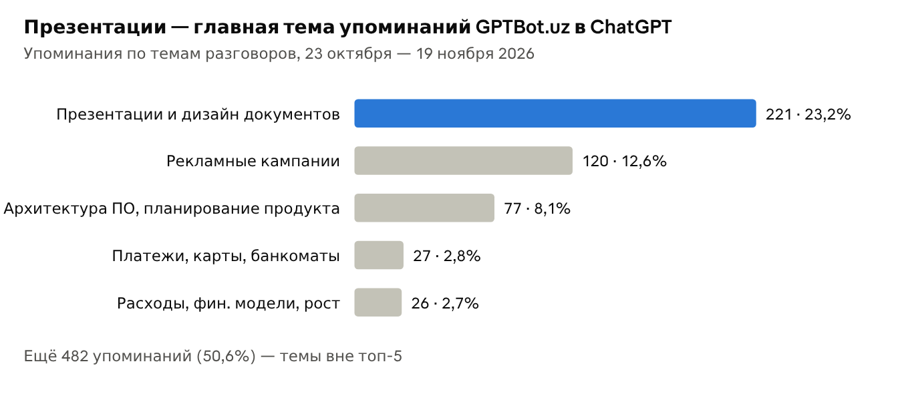

<!-- Source: owner upload «GPTBot.uz — что спрашивают у ИИ и как чаще попадать в ответы ChatGPT».docx, 23.11.2026 (Brain Digger). Converted to Markdown with pandoc on 23.11.2026; text unchanged. Fact check against production and code: VERIFICATION.md in this folder. -->

# GPTBot.uz: что спрашивают у ИИ и как чаще попадать в ответы ChatGPT

Nov 23, 2026 · @Brain Digger

## Коротко

ChatGPT упоминает GPTBot.uz примерно 47 раз в день (1 281 упоминание и 310 переходов за 27 учтённых дней), но почти только по брендовым вопросам. На нейтральные вопросы, где нас ищут без названия, ChatGPT не назвал нас ни разу.

1.  **ChatGPT и Google видят разный GPTBot.uz.** В Google ~90% кликов дают запросы про доступ к ChatGPT на узбекском. В ChatGPT главная тема упоминаний — презентации (23,2%), затем реклама (12,6%) и планирование продукта (8,1%).

2.  **На нейтральные вопросы нас нет.** В последнем замере трекера (23.11) ChatGPT назвал GPTBot.uz в 5 ответах из 32: в 4 брендовых и в 1 нишевом. В 13 вопросах вида «какой узбекский AI-чат», «чат с оплатой через Click», «кто делает AI-ботов в Ташкенте» нас нет.

3.  **Вместо нас ChatGPT берёт страницы, которые прямо отвечают списком.** Например, coreai.uz с англоязычной страницей «Free AI Chat in Uzbekistan» и студии с адресом, телефоном и Telegram в открытом виде (akri.uz, eurosoft.uz, innosoft.uz, bluecoredev.uz).

4.  **Bing Copilot уже цитирует нас 250 раз за полгода**, и всегда практические инструкции: как скачать ChatGPT (106 цитирований), узбекский чат (31), как подключить ChatGPT к Telegram-боту (16), ChatGPT и Claude в Узбекистане (16), как оплатить ChatGPT (12). Этот формат работает, его надо масштабировать.

5.  **Самый большой рычаг — презентации.** Это тема №1 в ChatGPT, а на сайте под неё 6 страниц из 427.

6.  **Второй рычаг — оплата AI-сервисов картами Узбекистана.** CTR 7,6% в Google, цитирования в Copilot, отдельная тема в ChatGPT, англоязычные запросы ассистентов. При этом на сайте 1 статья, и только на русском.

7.  **Английского слоя нет (0 страниц).** Ассистенты ищут по-английски: в Bing видны запросы вроде «uzbekistan telegram bot payments click payme official api». Их забирают сайты с английскими страницами.

8.  **Данные о компании противоречат друг другу.** На двух страницах оферты один адрес, на остальных 425 страницах и в llms.txt — другой. В Business Hub название «GPTbot.uz», на сайте «GPTBot.uz». ИИ хуже доверяет сущности с расходящимися фактами.

## Откуда данные и чего мы не видим

Точных текстов того, что люди пишут в ChatGPT, не даёт никто. Поэтому спрос собран по косвенным источникам, и у каждого свой срез.

| Источник                              | Период                   | Что показывает                                                                            |
|---------------------------------------|--------------------------|-------------------------------------------------------------------------------------------|
| ChatGPT Business Hub → Insights       | 23.10–19.11.2026         | Сколько раз ChatGPT упомянул бизнес, клики на сайт, 5 главных тем разговоров              |
| Bing Webmaster → AI Performance       | 6 мес., до 21.11         | Цитирования в Copilot и у партнёров Microsoft, процитированные страницы, пример запроса   |
| Bing Webmaster → Search Performance   | 6 мес.                   | 364 запроса из поиска Bing, на который опирается поиск ChatGPT                            |
| Google Search Console (через OpenSEO) | 20.08–20.11.2026         | Запросы и страницы в Google                                                               |
| Трекер AI-видимости OpenSEO           | 08–23.11.2026, 6 замеров | 32 вопроса к ChatGPT, Google AI Overviews, AI Mode и Perplexity: кого называют и цитируют |
| Сайт gptbot.uz                        | 23.11.2026               | 427 URL из sitemap, robots.txt, llms.txt, разметка                                        |

Ограничения:

- Агент в ChatGPT опубликован только сегодня, поэтому по его разговорам данных пока нет.

- Bing показывает лишь выборку запросов, по которым Copilot нас цитировал (один запрос).

- Новые платные исследования ключевых слов не покупались: в журнале OpenSEO записано не перепокупать срезы до 21–22.12. Выводы о спросе опираются на исследования 04.10, 16–17.11 и 20–22.11, уже лежащие в проекте.

- Трекер считает упоминанием chatgpt.uz само слово «ChatGPT» в ответе. Эти «упоминания» конкурента ложные, в выводах они не учтены.

## Что показывает ChatGPT Business Hub

За 28 дней ChatGPT упомянул GPTBot.uz 1 281 раз и отправил на сайт 310 человек, то есть каждое четвёртое упоминание заканчивается переходом. Пик был 25–28 октября (около 90–100 в день), сейчас 35–50 в день. За последнюю неделю 239 упоминаний, это на 17% меньше, чем неделей раньше.

ChatGPT Business Hub → Insights → Top 5 discovery topics · 23.10–19.11.2026 (27 из 28 дней)

Какие страницы, скорее всего, стоят за темами. Hub страницы не называет, это наше сопоставление с сайтом:

- **Презентации:** Studio (/uz/taqdimot-ai/, /ru/prezentatsiya-ai/) и гайды про Gamma и слайды. Это всего 6 URL, и агент до сегодня о Studio не знал.

- **Реклама:** статьи о стоимости интернет-рекламы, контекста, таргета и Telegram Ads — кластер из 47 страниц.

- **Архитектура и планирование:** статьи про ТЗ, этапы разработки и тестирование Telegram-ботов.

- **Платежи и карты:** «Как оплатить ChatGPT в Узбекистане» и приём оплаты Payme/Click в боте.

- **Расходы и рост:** калькуляторы ROI и окупаемости чат-бота, ROAS.

Темы про AI-чат на узбекском в топ-5 нет, хотя именно они дают сайту основной трафик из Google.

## Где ИИ уже цитирует сайт: Bing Copilot

Copilot и партнёры Microsoft процитировали gptbot.uz 250 раз за полгода (246 из них — за последние 3 месяца) по 23 страницам. Поиск ChatGPT опирается на индекс Bing, поэтому эти страницы — лучшие примеры того, что ИИ готов брать. В выборке Bing один запрос: «chat gpt yuklab olish», 75 цитирований (48%).

| Страница                                                                                                                        | Цитирований | Формат                |
|---------------------------------------------------------------------------------------------------------------------------------|-------------|-----------------------|
| [/uz/blog/chatgpt-telefon-va-kompyuterga-yuklab-olish/](https://gptbot.uz/uz/blog/chatgpt-telefon-va-kompyuterga-yuklab-olish/) | 106         | Пошаговая инструкция  |
| [/uz/gpt-uzbek-tilida/](https://gptbot.uz/uz/gpt-uzbek-tilida/)                                                                 | 31          | Продукт (чат) + FAQ   |
| [/ru/blog/kak-podklyuchit-chatgpt-k-telegram-botu/](https://gptbot.uz/ru/blog/kak-podklyuchit-chatgpt-k-telegram-botu/)         | 16          | Технический гайд      |
| [/ru/blog/chatgpt-i-claude-v-uzbekistane/](https://gptbot.uz/ru/blog/chatgpt-i-claude-v-uzbekistane/)                           | 16          | Доступ из Узбекистана |
| [/uz/gpt-uzbek-tilida-ai-chat/](https://gptbot.uz/uz/gpt-uzbek-tilida-ai-chat/)                                                 | 15          | Продукт               |
| [/ru/blog/kak-oplatit-chatgpt-v-uzbekistane/](https://gptbot.uz/ru/blog/kak-oplatit-chatgpt-v-uzbekistane/)                     | 12          | Оплата картами        |
| [/uz/blog/insho-yozish-suniy-intellekt-bilan/](https://gptbot.uz/uz/blog/insho-yozish-suniy-intellekt-bilan/)                   | 11          | Учёба                 |
| [/uz/blog/referat-va-mustaqil-ish/](https://gptbot.uz/uz/blog/referat-va-mustaqil-ish/)                                         | 8           | Учёба                 |
| [/ru/o-kompanii/](https://gptbot.uz/ru/o-kompanii/)                                                                             | 8           | О компании            |
| /uz/blog/chatgpt-ozbekistonda-vpnsiz-ishlaydimi/                                                                                | 4           | Доступ                |
| /uz/blog/marketing-nima/                                                                                                        | 4           | Объяснение термина    |
| /ru/blog/priem-oplaty-payme-click-v-telegram-bote/                                                                              | 3           | Оплата в боте         |

Ещё 11 страниц процитированы 1–2 раза: курсовая, стоимость рекламы, тестирование и этапы разработки бота, ROI бота, промпты, аналоги ChatGPT. Ни одна коммерческая страница услуг (сайты, SEO, SMM) в список не попала.

### Что ищут в самом Bing

За полгода 88 кликов и 6,7 тыс. показов по 364 запросам. Верх тот же, что в Google: «chat gpt kirish» (1,8 тыс.), «chat gpt uzbek tilida» (1,4 тыс.), «чат gpt онлайн» (411). В хвосте много длинных англоязычных запросов в стиле ИИ-ассистента, который собирает ответ:

- gptbot uzbekistan clinic ai bot pricing funding launched

- uzbekistan telegram bot payments click payme uzum official api merchant

- chatgpt plus payment methods uzbekistan cards visa mastercard

- компании, создающие ai-чат-ботов для бизнеса в ташкенте

- сколько заявок в месяц нужно для окупаемости чат-бота

Также видно, что школьники и студенты вводят в поиск задание целиком: «qonun oldida barchamiz tengmiz mavzusida insho rejasi bilan», «insho yozish namunasi», «prompt nima o‘zbek tilida».

### Что ищут в Google (контекст)

За 3 месяца сайт получил основные клики с трёх страниц: /uz/gpt-uzbek-tilida/ (1 878 кликов, 223 тыс. показов), гайд по скачиванию (1 571 / 77,5 тыс.), /ru/gpt-chat/ (819 / 191 тыс.). Самый высокий CTR — у «Как оплатить ChatGPT в Узбекистане»: 7,6% при позиции 4,2. Большие объёмы с низким CTR: «chatgpt kirish» (166 тыс. показов, 0,4%), «чачи пити» (52 тыс., 0,1%), «чати пити» (29 тыс., 0,1%), «chatgpt yozish» (25,5 тыс., 0,6%), «jaji piti» (24,7 тыс., 0,4%).

## Где ChatGPT нас не называет и кого называет вместо нас

ChatGPT — самый слабый для нас ИИ. За 28 дней он упомянул сайт в 2,1% нейтральных ответов и процитировал в 3,6%. Для сравнения: Google AI Overviews упоминают нас в 18,3% ответов, Google AI Mode цитирует в 66,7%, Perplexity упоминает и цитирует в 25%.

В последнем замере (23.11, 32 вопроса к ChatGPT) на все 4 брендовых вопроса ChatGPT отвечает правильно и со ссылкой на нас. Из нейтральных нас назвали только один раз — в вопросе об автоматизации заявок для кондитерской (кейс Cake City). На 12 коротких поисковых запросов («chatgpt kirish», «чачи пити» и т. п.) ChatGPT ведёт на chatgpt.com — там торговаться не за что.

| Вопрос к ChatGPT                                              | Кого он назвал или процитировал                                             | Наша страница на эту тему                                   |
|---------------------------------------------------------------|-----------------------------------------------------------------------------|-------------------------------------------------------------|
| O‘zbek tilida bepul AI chat qaysi?                            | ChatGPT, Gemini, Copilot, DeepSeek, CoreAI (coreai.uz, английская страница) | /uz/gpt-uzbek-tilida/                                       |
| ChatGPT’ga o‘xshash o‘zbekcha AI chat bormi?                  | elnazariy.uz, hayot.ai, salom-ai.uz                                         | /uz/gpt-uzbek-tilida/                                       |
| Ro‘yxatdan o‘tmasdan o‘zbekcha AI chat?                       | bota.chat, notrack.ai                                                       | /uz/gpt-uzbek-tilida/                                       |
| O‘zbekcha AI chat narxi va bepul sinov shartlari              | marsit.uz, uzneo.com, farq.uz                                               | /uz/oferta/ (отдельной узбекской страницы тарифов чата нет) |
| Click yoki Payme orqali to‘lanadigan AI chat bormi?           | getory.uz, baronpay.uz                                                      | нет                                                         |
| Какой ИИ-чат можно оплатить через Click?                      | getory.uz, Telegram                                                         | /ru/tarify-ai-chat/                                         |
| Какой ИИ-чат лучше всего понимает узбекский?                  | ai.sqb.uz, aslmatn.uz, azamat.ai                                            | нет сравнения                                               |
| Где пользоваться ChatGPT в Узбекистане бесплатно?             | chatgpt.com, help.openai.com                                                | /ru/gde-polzovatsya-gpt-besplatno/                          |
| Как оплатить ИИ-чат из Узбекистана без иностранной карты?     | help.openai.com                                                             | /ru/blog/kak-oplatit-chatgpt-v-uzbekistane/                 |
| Где попробовать ИИ-чат на русском без регистрации?            | duck.ai, Алиса, Gemini, neiroskop.ru, t-j.ru и др. (8 ссылок)               | /ru/gpt-chat/                                               |
| Toshkentda Telegram uchun AI bot yaratib beradigan kompaniya  | akri.uz, Tezcode, eurosoft.uz, innosoft.uz, bluecoredev.uz                  | /uz/biznes-uchun-ai-bot/                                    |
| Сколько стоит Telegram-бот для заявок в Ташкенте?             | innosoft.uz, devuz.studio, necto.uz, odilient.com                           | /ru/razrabotka-telegram-bota-tashkent/ (цены есть)          |
| Instagram va Telegram mijozlarini CRM ga qanday ulash mumkin? | core.telegram.org, developers.facebook.com                                  | нет узбекского гайда                                        |

Что общего у тех, кого ChatGPT называет:

- **Страница отвечает на вопрос дословно**, часто в заголовке: «Free AI Chat in Uzbekistan — Uzbek, Russian, English».

- **Ответ оформлен списком или сравнением.** ChatGPT собирает топ-5 из страниц, где такой список уже есть.

- **У компаний факты видны сразу:** адрес, телефон, Telegram, что именно делают. Ответ собран из карточек: что делают, контакты, сайт.

- **Нас есть чем заменить:** по каждому вопросу таблицы, кроме трёх, у нас уже есть страница. Она просто не сформулирована как прямой ответ или не находится по английскому запросу ассистента.

## Что люди спрашивают: 9 кластеров

Спрос складывается в 9 тем. Таблица отсортирована по тому, насколько тема недобрана в ИИ при том спросе, который мы уже видим.

| \#  | Кластер                               | Как спрашивают                                                                                        | Сигнал спроса                                                                                          | Сейчас на сайте                                                                 |
|-----|---------------------------------------|-------------------------------------------------------------------------------------------------------|--------------------------------------------------------------------------------------------------------|---------------------------------------------------------------------------------|
| 1   | Презентации и слайды                  | taqdimot tayyorlash, slayd yasash AI, gamma app, slayd uchun fon, презентация с ИИ                    | Тема №1 в ChatGPT (23,2%); сезон gamma app (исследование 17.11)                                        | 6 URL                                                                           |
| 2   | Оплата AI-сервисов из Узбекистана     | chatgpt plus uzcard, visa для chatgpt, Click/Payme orqali AI chat, как оплатить без иностранной карты | Тема в ChatGPT (2,8%); CTR 7,6% в Google; 12 цитирований Copilot; англоязычные запросы ассистентов     | 1 статья, только RU                                                             |
| 3   | Какой узбекский AI-чат выбрать        | o‘zbek tilida bepul AI chat qaysi, ChatGPT’ga o‘xshash, какой ИИ лучше понимает узбекский             | 7 вопросов трекера, везде называют других                                                              | Страницы продукта есть; честного сравнения на узбекском и английской версии нет |
| 4   | Компании и цены на AI-/Telegram-ботов | kim AI bot yaratib beradi, сколько стоит бот, Payme/Click в боте, окупаемость, тестирование, ТЗ       | Темы ChatGPT «архитектура» 8,1% и «расходы» 2,7%; 2 вопроса трекера без нас; англоязычные запросы Bing | 134 URL про ботов, но 2 кейса и нет обзора рынка                                |
| 5   | Другие ИИ в Узбекистане               | Gemini/Claude/DeepSeek o‘zbekcha, ishlaydimi, qanday kirish                                           | 16 цитирований Copilot; спрос Gemini и Claude растёт в разы (исследование 17.11)                       | 7 URL                                                                           |
| 6   | Учёба и тексты                        | insho, referat, kurs ishi, murakkab reja, задание целиком в поиске                                    | 21 цитирование Copilot; учебные запросы растут (исследование 17.11)                                    | 7 учебных + 30 образцов документов                                              |
| 7   | Промпты                               | prompt nima, chatgpt uchun prompt, промты для gpt                                                     | 44 клика на /ru/promty-gpt-chatgpt-50-primerov/; запросы в Bing                                        | 2 URL                                                                           |
| 8   | Реклама, SMM, SEO                     | сколько стоит реклама в Узбекистане, таргет цена, Telegram Ads                                        | Тема №2 в ChatGPT (12,6%)                                                                              | 47 URL                                                                          |
| 9   | Доступ к ChatGPT по-узбекски          | chatgpt kirish, yuklab olish, uzbekcha, чачи пити, jaji piti                                          | Главный объём Google и Bing; 137 цитирований Copilot                                                   | Покрыт сильно; в самом ChatGPT такие запросы уходят на chatgpt.com              |

Кластер 9 даёт трафик из Google и Copilot, но для роста именно в ChatGPT полезен меньше всего.

## Пробелы сайта

Технически сайт к ИИ готов: все AI-краулеры (OAI-SearchBot, ChatGPT-User, GPTBot, ClaudeBot и др.) открыты в robots.txt, есть llms.txt и llms-full.txt, на страницах есть разметка Organization, Service и FAQPage. Не хватает содержания в том виде, в каком ИИ его берёт.

1.  **Нет английского слоя.** 0 из 427 URL, /en/ отдаёт 404. Ассистенты ищут по-английски, и конкурент coreai.uz получил цитату именно английской страницей.

2.  **Презентации покрыты слабо:** 6 URL под тему №1 в ChatGPT. Нет страниц по предметам (история, биология, бизнес-план), сравнений Studio с Gamma и Canva, инструкций «слайды для защиты курсовой».

3.  **Оплата AI-сервисов — одна русская статья.** Нет узбекской версии, нет статей про оплату Claude, Gemini, Midjourney и про то, какие карты (Uzcard, Humo, Visa) работают, нет страницы «AI-чаты с оплатой через Click/Payme».

4.  **Нет честных сравнений на узбекском.** Из страниц-сравнений на узбекском есть только GPTBot vs BotMother vs SendPulse. Нет «o‘zbekcha AI chatlar: taqqoslash» с критериями (язык, бесплатный лимит, оплата, регистрация) — а именно такие списки ChatGPT пересказывает.

5.  **Тарифы AI-чата по-узбекски лежат только в оферте.** /uz/tariflar/ посвящена Studio. Узбекской пары для /ru/tarify-ai-chat/ нет.

6.  **Мало доказательств для бизнес-вопросов.** 134 URL про ботов, но 2 кейса. ChatGPT назвал нас единственный раз вне бренда именно из-за кейса (кондитерская).

7.  **Промпты — 2 страницы**, хотя обе работают (CTR 2,0–2,6%) и цитируются.

8.  **Расхождения в данных о компании.** В футере /ru/oferta/ и /uz/oferta/ указано «Yahyo Gulyamov ko‘chasi 35», а на остальных 425 страницах, в разметке и в llms.txt — «Kichik Xalqa Yo‘li 57». В sameAs только Яндекс.Карты и GitHub; нет Telegram-канала, Business Hub, 2GIS, Google Business Profile, LinkedIn.

9.  **Мало упоминаний на чужих сайтах.** ChatGPT собирает списки с каталогов и подборок. В исследовании 22.11 уже есть 50 площадок для размещения; сейчас этот рычаг не задействован.

## План: что писать и менять

Начинать стоит с данных о компании и английского слоя: это дёшево и нужно всем остальным страницам. Затем идут два кластера с самым большим недобором: презентации и оплата.

| Волна | Что сделать                                                                                                                                                                  | Почему                                                                            | Как поймём, что сработало                                          |
|-------|------------------------------------------------------------------------------------------------------------------------------------------------------------------------------|-----------------------------------------------------------------------------------|--------------------------------------------------------------------|
| 1     | Выровнять данные о компании: один адрес (или явно «офис» и «юридический»), расширить sameAs, обновить llms.txt (Studio, цены, услуги)                                        | ИИ склеивает сущность по совпадающим фактам                                       | Адрес один на всех 427 URL; брендовые вопросы трекера остаются 4/4 |
| 1     | Английский слой /en/: 6–8 страниц (о компании, узбекский AI-чат, Studio, AI-боты с ценами, оплата AI-сервисов из Узбекистана, сравнение узбекских AI-чатов) + hreflang       | Ассистенты ищут по-английски; coreai.uz цитируют за английскую страницу           | Английские страницы в Bing AI Performance и в источниках трекера   |
| 1     | Узбекская страница тарифов AI-чата (пара к /ru/tarify-ai-chat/)                                                                                                              | Вопросы про цену и лимиты чата задают по-узбекски, а ответ сейчас только в оферте | Вопрос про цену и синал в трекере цитирует нас                     |
| 1     | Честное сравнение узбекских AI-чатов (UZ/RU/EN): таблица по языку, бесплатному лимиту, регистрации, оплате, дата проверки                                                    | ChatGPT пересказывает готовые списки; 7 вопросов трекера без нас                  | GPTBot.uz появляется в ответах трекера на кластер 3                |
| 2     | Кластер презентаций: хаб + 10–15 страниц (предметы, защита курсовой и диплома, бизнес-план, структура и правила слайдов, Studio vs Gamma vs Canva)                           | Тема №1 в ChatGPT, 6 URL                                                          | Доля темы в Business Hub и цитирования Copilot на новые URL        |
| 2     | Кластер оплаты: узбекская версия «как оплатить ChatGPT», оплата Claude / Gemini / Midjourney, какие карты работают, AI-чаты с оплатой через Click/Payme                      | Лучший CTR сайта, цитируется, есть отдельная тема в ChatGPT                       | Трекер: вопросы про Click/Payme и иностранную карту цитируют нас   |
| 3     | Доказательства для бизнеса: 3–5 реальных кейсов с цифрами, нейтральный чек-лист «как выбрать подрядчика на AI-бота в Ташкенте», узбекский гайд «Instagram va Telegram → CRM» | Единственное небрендовое упоминание дал кейс                                      | Вопросы про компании и цены ботов цитируют нас                     |
| 3     | Библиотека промптов UZ/RU по задачам (учёба, резюме, SMM, бизнес); обновить гайды про Gemini, Claude, DeepSeek                                                               | Работающий формат, растущий спрос                                                 | Клики GSC и цитирования Copilot                                    |
| 3     | Присутствие на чужих сайтах: площадки из списка 22.11, статьи в узбекских медиа, Telegram-канал, короткие видео                                                              | ChatGPT собирает списки не только с нашего сайта                                  | Упоминания в Business Hub растут без роста брендового трафика      |

Формат каждой новой страницы (так ИИ её берёт):

- Первые 2 предложения дают прямой ответ с цифрой: цена, лимит, срок.

- Подзаголовки сформулированы вопросами, как их задают люди.

- Сравнения сведены в таблицу, инструкции разбиты на нумерованные шаги.

- Указана дата проверки, есть автор, источники и FAQ.

- Никаких выдуманных цен, отзывов, рейтингов и слова «rasmiy».

## Промт для агента

Промт рассчитан на агента с доступом к репозиторию сайта (тот же, что делал фид). Скопируйте его целиком.

\# Задача: сделать gptbot.uz источником, который ChatGPT и другие ИИ называют и цитируют  
  
\## Контекст (данные на 23.11.2026)  
- ChatGPT упоминает GPTBot.uz ~1 281 раз за 28 дней (310 кликов), но почти только на брендовые вопросы.  
В трекере OpenSEO (32 вопроса) ChatGPT назвал нас в 5 ответах: 4 брендовых + 1 кейс.  
- Темы упоминаний в ChatGPT (Business Hub): презентации 23,2%, реклама 12,6%,  
архитектура ПО и планирование 8,1%, платежи и карты 2,8%, расходы и рост 2,7%.  
- Bing Copilot процитировал сайт 250 раз за 6 мес., только практические инструкции:  
/uz/blog/chatgpt-telefon-va-kompyuterga-yuklab-olish/ (106), /uz/gpt-uzbek-tilida/ (31),  
/ru/blog/kak-podklyuchit-chatgpt-k-telegram-botu/ (16), /ru/blog/chatgpt-i-claude-v-uzbekistane/ (16),  
/ru/blog/kak-oplatit-chatgpt-v-uzbekistane/ (12).  
- На нейтральные вопросы ChatGPT называет других:  
- coreai.uz — по английской странице «Free AI Chat in Uzbekistan»;  
- getory.uz — про Click/Payme;  
- salom-ai.uz, hayot.ai, ai.sqb.uz, azamat.ai;  
- студии akri.uz, eurosoft.uz, innosoft.uz, bluecoredev.uz.  
- На сайте 427 URL: 210 RU, 215 UZ, 0 EN.  
Презентации — 6 URL. Оплата AI-сервисов — 1 RU-статья. Промпты — 2. Кейсы — 2.  
- robots.txt уже открыт для всех AI-ботов, llms.txt и llms-full.txt есть. Это не трогать, только расширять.  
  
\## Правила репозитория (обязательно)  
1. Перед работой прочитай:  
- content/seo/intent-manifest.json — кто владеет каким интентом;  
- content/seo/demand-policy.json — новая коммерческая страница должна называть измеренный спрос, иначе сборка её не примет;  
- docs/seo/CHANGE_LOG_2026-11.md — активные тесты и базовые значения, их не ломать.  
2. Контент лежит в JSON (content/pages, content/blog) с типизированными блоками. Используй существующие типы блоков, сайт не переписывай.  
3. Узбекские тексты пишутся с нуля, а не переводятся.  
Орфография: U+2018 для o‘/g‘, U+2019 для тутуқ белгиси. ASCII-апостроф между буквами валит сборку.  
4. Запрещено:  
- выдуманные цены, сроки, кейсы, числа клиентов, отзывы, рейтинги;  
- разметка Offer/Review/AggregateRating без реальных видимых данных;  
- обещания позиций;  
- слова «official/rasmiy/официальный» и любой намёк на связь с OpenAI.  
5. Цены и условия бери только из источника правды, которым пользуется scripts/openai-feed.ts:  
код оплаты чата, файл тарифов Studio, таблицы пакетов услуг. Из памяти цены не пиши.  
6. Каждая волна = отдельная ветка → PR → тесты и сборка зелёные → merge → деплой → IndexNow для новых и изменённых URL.  
В main напрямую не пушить.  
7. Что нельзя проверить — так и пиши в отчёте. Результаты не выдумывать.  
  
\## Формат каждой новой или переписанной страницы (answer-first)  
- Первые 1–2 предложения — прямой ответ на главный вопрос страницы с цифрой (цена, лимит, срок, шаги).  
- H1 и title совпадают с тем, как спрашивают (примеры формулировок ниже). H2 — вопросами.  
- Сравнения — таблицей. Инструкции — нумерованными шагами.  
- Блок «Коротко» в начале: 3–5 фактов, которые ИИ может процитировать дословно.  
- Дата «проверено», автор, источники со ссылками, FAQ (FAQPage только на видимые вопросы).  
- Ссылки со статьи на нужный продукт (чат, Studio, боты) и обратно с хаба; hreflang пары uz/ru/en.  
  
\## Волна 1 — фундамент (первый PR)  
1. \*\*Данные о компании в одном месте.\*\*  
- Вынести в одну константу: название «GPTBot.uz», адрес, телефон, e-mail, часы работы, юрлицо.  
- Сейчас адреса расходятся: в футере /ru/oferta/ и /uz/oferta/ «Yahyo Gulyamov ko‘chasi 35», на остальных страницах, в разметке и llms.txt «Kichik Xalqa Yo‘li 57».  
- Какой адрес правильный (или офис отдельно от юрадреса), решает владелец. Спроси до изменения, сам не выбирай.  
- Расширить Organization.sameAs только реальными профилями, которые существуют и отдают 200. Список спроси у владельца.  
2. \*\*llms.txt и llms-full.txt.\*\*  
- Добавить Studio (тарифы из файла тарифов), тарифы AI-ботов, сайтов, SEO, SMM, рекламы — из таблиц пакетов, с пометкой «от».  
- Добавить ссылку на https://gptbot.uz/openai-product-feed.jsonl и на новые /en/ страницы.  
- Раздел «Quick answers» дополнить вопросами из раздела «Вопросы, на которые нужно отвечать».  
3. \*\*Английский слой /en/\*\* (новая локаль в той же системе контента, sitemap, hreflang, canonical):  
- /en/ — кто мы: Tashkent team, independent AI chat in Uzbek and Russian, AI presentation maker, AI bots for business; not ChatGPT, not OpenAI;  
- /en/uzbek-ai-chat/ — free Uzbek AI chat: 3 free replies, no registration, packs and prices, Click/Payme;  
- /en/ai-presentation-maker/ — Studio: free sample, Daily/Monthly, .pptx;  
- /en/ai-chatbot-development-tashkent/ — AI bots for Telegram/Instagram/WhatsApp, пакеты «from», CRM, контакты;  
- /en/pay-for-chatgpt-in-uzbekistan/ — как оплатить ChatGPT/Claude/Gemini из Узбекистана (факты проверить и датировать);  
- /en/uzbek-ai-chats-compared/ — сравнение (см. п. 5).  
Каждая /en/-страница — короткая, фактологичная, со ссылкой на полную UZ/RU-версию.  
На demand-policy: оформи /en/ как информационный слой с ссылкой на этот анализ (спрос = запросы ассистентов в Bing + трекер).  
Если политика не пропускает — остановись и напиши, чего не хватает.  
4. \*\*Узбекская страница тарифов AI-чата\*\* (например /uz/ai-chat-tariflari/), hreflang-пара к /ru/tarify-ai-chat/.  
/uz/tariflar/ остаётся страницей Studio; добавь с неё ссылку на тарифы чата.  
5. \*\*Честное сравнение узбекских AI-чатов\*\* (UZ — основная, RU, EN):  
- таблица: ChatGPT, Gemini, Copilot, DeepSeek, GPTBot.uz и местные сервисы, которые называет ChatGPT (coreai.uz, salom-ai.uz, hayot.ai и др.);  
- критерии: узбекский (латиница), русский, бесплатный лимит, нужна ли регистрация, оплата узбекскими картами или Click/Payme, особенности;  
- каждый факт о чужом сервисе проверить на его сайте в день публикации и дать ссылку и дату; не проверил — не пиши;  
- тон нейтральный, без оценок конкурентов, с блоком «кому что подойдёт»;  
- там, где GPTBot.uz не лучший вариант, так и написать.  
  
\## Волна 2 — кластеры с наибольшим недобором  
6. \*\*Презентации\*\* (тема №1 в ChatGPT, сейчас 6 URL). Хаб + 10–15 страниц, UZ в первую очередь, затем RU:  
- taqdimot tayyorlash: qadamlar, tuzilish, slaydlar soni;  
- kurs ishi va diplom himoyasi uchun taqdimot;  
- fanlar bo‘yicha: tarix, biologiya, iqtisodiyot, ingliz tili, ona tili — только те, что проходят demand-policy;  
- biznes-reja / startap taqdimoti;  
- slayd dizayni qoidalari, shrift va ranglar;  
- GPTBot Studio, Gamma, Canva, PowerPoint Copilot — сравнение с датой проверки;  
- «презентация с ИИ бесплатно» (RU).  
Каждая страница ведёт на Studio (бесплатный пример) и называет точные лимиты из файла тарифов.  
7. \*\*Оплата AI-сервисов из Узбекистана\*\* (лучший CTR сайта, 7,6%):  
- UZ-версия «ChatGPT uchun qanday to‘lash mumkin»;  
- оплата Claude, Gemini, Midjourney RU/UZ;  
- «Qaysi kartalar ishlaydi: Uzcard, Humo, Visa»;  
- «Click/Payme bilan to‘lanadigan AI chatlar» (список с проверенными фактами, GPTBot.uz — один из пунктов).  
Никаких схем обхода правил платёжных систем и санкций. Каждый способ с датой проверки и ссылкой на первоисточник.  
  
\## Волна 3 — доверие и длинный хвост  
8. \*\*Кейсы.\*\* Формат кейсов с цифрами (как /ru/blog/keys-cake-city-...). Факты и цифры запроси у владельца, сам не придумывай. Пока фактов нет — только шаблон.  
9. \*\*Нейтральные гайды для бизнеса:\*\*  
- «Toshkentda AI bot buyurtma qilish: pudratchini qanday tanlash (chek-list)» + RU;  
- «Instagram va Telegram mijozlarini CRM ga ulash» (UZ, AmoCRM/Bitrix24).  
10. \*\*Промпты:\*\* библиотека UZ/RU по задачам (o‘qish, rezyume, SMM, biznes, tarjima), с перелинковкой на чат.  
11. \*\*Гайды Gemini/Claude/DeepSeek в Узбекистане:\*\* обновить факты и даты; добавить DeepSeek, если нет.  
  
\## Вопросы, на которые сайт должен отвечать дословно (формулировки для H1/H2/FAQ)  
- O‘zbek tilida bepul AI chat qaysi? / ChatGPT’ga o‘xshash o‘zbekcha AI chat bormi?  
- Ro‘yxatdan o‘tmasdan o‘zbekcha AI chat qayerda?  
- O‘zbekcha AI chat narxi va bepul sinov shartlari  
- Click yoki Payme orqali to‘lanadigan AI chat bormi?  
- Какой ИИ-чат лучше всего понимает узбекский? / Which AI chat understands Uzbek best?  
- Как оплатить ChatGPT / ИИ-чат из Узбекистана без иностранной карты? / How to pay for ChatGPT Plus in Uzbekistan?  
- Taqdimotni AI bilan qanday tayyorlash mumkin? / Как сделать презентацию с ИИ бесплатно?  
- Toshkentda Telegram uchun AI bot yaratib beradigan kompaniya / AI chatbot development company in Tashkent  
- Сколько стоит Telegram-бот для заявок в Ташкенте и что входит?  
- Instagram va Telegram mijozlarini CRM ga qanday ulash mumkin?  
  
\## Проверка и отчёт (по каждой волне)  
- Build, все тесты, орфография, demand-policy и intent-manifest — зелёные; фид и его защита деплоя целы.  
- На проде:  
- каждый новый URL отдаёт 200 и есть в sitemap;  
- hreflang-пары взаимны;  
- llms.txt обновлён;  
- адрес одинаков на всех URL (пройти весь sitemap скриптом).  
- IndexNow для всех новых и изменённых URL.  
- Отчёт:  
- таблица URL / язык / главный вопрос / источник фактов;  
- что осталось на решение владельца (адрес, sameAs, факты кейсов);  
- запись в docs/seo/CHANGE_LOG с базой для замера через 14 и 28 дней.
